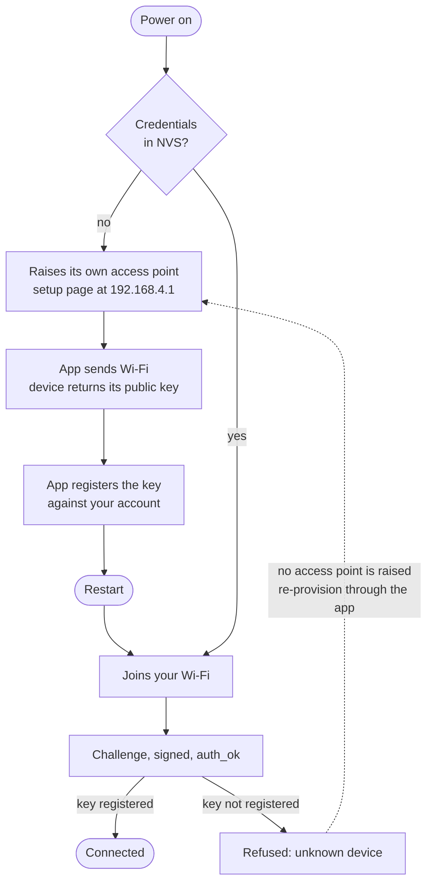
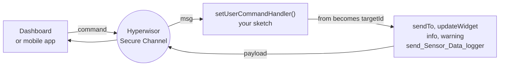

# Hyperwisor IoT — Arduino Library

[](https://www.arduino.cc/reference/en/libraries/)
[](https://www.espressif.com/en/products/socs/esp32)
[](#security)
[](License.md)

Connect an ESP32 to the [Hyperwisor](https://www.hyperwisor.com/) platform in a
few lines. The library handles Wi-Fi provisioning, an authenticated real-time
channel, OTA updates, GPIO control and JSON command execution, so a sketch can
be about the product rather than the plumbing.

Every device holds a **unique ECDSA P-256 keypair generated on-chip**. The
private key never leaves the ESP32, and the device proves its identity to the
Hyperwisor Secure Channel before any data flows.

---

## Install

**Arduino IDE** — Tools → Manage Libraries, search `Hyperwisor-IOT`, install.

**arduino-cli**

```bash
arduino-cli lib install Hyperwisor-IOT
```

You also need the ESP32 board package (`esp32` by Espressif Systems) and two
libraries, both from Library Manager:

| Library | Author |
|---|---|
| [ArduinoJson](https://arduinojson.org/) | Benoit Blanchon |
| [WebSockets](https://github.com/Links2004/arduinoWebSockets) | Markus Sattler |

Everything else — `WiFi`, `WebServer`, `HTTPClient`, `WiFiClientSecure`,
`Preferences`, `Update`, `DNSServer`, `Wire` — ships with the ESP32 board
package.

---

## Quick start

```cpp
#include <hyperwisor-iot.h>

HyperwisorIOT device;

void setup() {
  Serial.begin(115200);
  device.begin();                       // Wi-Fi, identity, secure channel
  Serial.println("Device ID: " + device.getDeviceId());
}

void loop() {
  device.loop();                        // keeps the connection alive
}
```

That is a complete, connectable device. `begin()` restores saved credentials,
brings up the on-chip key and authenticates; `loop()` pumps messages and drives
reconnection.

---

## Getting a device onto your account

A device cannot simply connect. The relay only accepts devices whose public key
is registered to an account, so the first boot goes through provisioning:




1. **First boot** — no stored credentials, so the device raises its own access
   point (`NIKOLAINDUSTRY_Setup…`, password `0123456789`) and serves a setup
   page at `192.168.4.1`.
2. **Hand over Wi-Fi** — the Hyperwisor mobile app sends your network details to
   that page. The device replies with its **public key**, and the app registers
   it against your account.
3. **Restart** — the device joins your network and authenticates on the secure
   channel.

> A device flashed with Wi-Fi credentials already in NVS skips provisioning,
> never registers its key, and is refused as `unknown device`. Re-provision it
> through the app to fix this. There is no insecure fallback to wait for.

Change the access point with `setProvisioningAP()` before `begin()` if the
defaults do not suit your product.

---

## How a message flows

Everything the library sends is addressed to a `targetId`. Inside a command
handler that value is `msg["from"]` - the dashboard that asked - so a reply, a
widget update and a dialog all go back to wherever the command came from.



Hold that one idea and the rest of the API follows: **the thing you received
from is the thing you send to.**

---

## Receiving commands

The platform sends structured JSON. One message may carry several commands, each
with several actions:

```json
{
  "from": "controller-xyz",
  "payload": {
    "commands": [
      {
        "command": "GPIO_MANAGEMENT",
        "actions": [
          { "action": "ON", "params": { "gpio": 12, "pinmode": "OUTPUT", "status": "HIGH" } }
        ]
      }
    ]
  }
}
```

`GPIO_MANAGEMENT` and OTA are handled for you. Anything else reaches your
handler:

```cpp
device.setUserCommandHandler([](JsonObject &msg) {
  String from = msg["from"].as<String>();
  if (!msg.containsKey("payload")) return;

  for (JsonObject cmd : msg["payload"]["commands"].as<JsonArray>()) {
    if (cmd["command"] == "relay_control") {
      for (JsonObject a : cmd["actions"].as<JsonArray>()) {
        int  relay = a["params"]["relay"] | 0;
        bool on    = a["params"]["state"] == "true";
        // drive your hardware here
      }
    }
  }
});
```

The handler receives the **whole message**, not one command — read `from` and
`payload` off it. Replies and telemetry go back the same way:

```cpp
device.sendTo(from, [&](JsonObject &p) {
  p["status"] = "ok";
  p["relay"]  = 3;
});
```

---

## Connection behaviour

Since **3.3.0** reconnection backs off and spreads, rather than retrying at a
fixed interval.

| Situation | What happens |
|---|---|
| Ordinary drop | Retry after 1–3 s, then 2 s, 4 s, 8 s … capped at 60 s |
| Jitter | Each retry lands at a random point in a window as wide as the wait |
| Identity rejected | Flat 5 s retry, no escalation |
| Handshake completes | The backoff resets — only `auth_ok` counts as success |

The jitter matters once more than one device exists. A fixed interval means
every device reconnects in lockstep after a server restart, and the resulting
burst keeps the server down. A window that widens with the delay puts the
largest spread exactly where the crowd is biggest.

On a single device this is a trade: after a long outage, recovery can take up to
about 90 seconds instead of retrying every 2. An ordinary blip is unaffected.

Watch it on the serial monitor:

```
🔴 relay disconnected
⏳ next reconnect in 3184ms (closed, attempt 1)
🔐 HSC: signed challenge → sent auth
🔐 HSC: authenticated
```

---

## Security

Security is not a setting. `begin()` generates (or loads) the device's P-256
keypair in NVS, connects to the Hyperwisor Secure Channel and completes a
challenge–response handshake before the sketch can send anything.

- The **private key never leaves the chip**. Only the public key is ever shared.
- The keypair survives reboots and OTA updates, so the identity is stable.
- Frames written before the handshake finishes are held rather than sent, so a
  publishing loop that starts early cannot break the connection.

```cpp
device.getPublicKeyBase64();   // base64 raw P-256, safe to print or copy
device.getDeviceId();
```

---

## Dashboard widgets

Every call below addresses a widget on a Hyperwisor dashboard. `targetId` is
who you are sending to — inside a command handler that is `msg["from"]`, which
is the dashboard that asked. `widgetId` comes from the widget's settings on the
dashboard.

```cpp
device.updateWidget(from, "temp-gauge", 26.4f);
```

| Method | Use |
|---|---|
| `updateWidget(targetId, widgetId, String)` | Text widgets, status readouts |
| `updateWidget(targetId, widgetId, float)` | Gauges, progress bars, numbers |
| `updateWidget(targetId, widgetId, vector<float>)` | Graphs and charts |
| `updateWidget(targetId, widgetId, vector<int>)` | Graphs and charts |
| `updateWidget(targetId, widgetId, vector<String>)` | Lists and multi-value widgets |
| `updateCountdown(targetId, widgetId, h, m, s)` | Countdown widget; values as strings |
| `updateFlightAttitude(targetId, widgetId, roll, pitch)` | Artificial-horizon widget, degrees |
| `updateHeatMap(targetId, widgetId, vector<HeatMapPoint>)` | Heat map |
| `update3DModel(targetId, widgetId, modelUrl)` | Load a model into a 3D viewer |
| `update3DWidget(targetId, widgetId, vector<ThreeDModelUpdate>)` | Move, colour or hide models in a 3D viewer |
| `updateWidgetPosition(targetId, widgetId, x, y, w, h, r)` | Move or resize a widget; `r` is rotation |

### Supporting types

```cpp
struct HeatMapPoint {
  int x;       // pixels on the heat map
  int y;
  int value;   // intensity at that point
};

struct ThreeDModelUpdate {
  String modelId;
  float  position[3];   // x, y, z
  float  rotation[3];   // degrees about x, y, z
  float  scale[3];
  String color;         // "#RRGGBB"
  float  metalness;     // 0 matte … 1 metallic
  float  roughness;     // 0 smooth … 1 rough
  float  opacity;       // 0 invisible … 1 opaque
  bool   wireframe;
  bool   visible;
};
```

```cpp
std::vector<HeatMapPoint> pts = { {12, 40, 80}, {64, 96, 35} };
device.updateHeatMap(from, "floor-heat", pts);
```

---

## Messages to the operator

Raise a dialog on the dashboard. `showDialog()` takes any icon name; the five
named helpers are the usual severities and read better at the call site.

| Method | Use |
|---|---|
| `info(targetId, title, description)` | Neutral notice |
| `success(targetId, title, description)` | Something completed |
| `warning(targetId, title, description)` | Needs attention, still running |
| `error(targetId, title, description)` | Something failed |
| `risk(targetId, title, description)` | Unsafe condition |
| `showDialog(targetId, title, description, icon)` | Any other icon |

```cpp
device.warning(from, "Tank low", "Water level under 15%.");
```

---

## Telemetry and storage

| Method | Use |
|---|---|
| `send_Sensor_Data_logger(targetId, configId, {{"name", value}, …})` | Push readings to a Data Logger configuration |
| `insertDatainDatabase(productId, deviceId, table, builder)` | Insert a row |
| `getDatabaseData(productId, table, limit)` | Read rows; the reply arrives at your command handler |
| `updateDatabaseData(dataId, builder)` | Update a row by id |
| `deleteDatabaseData(dataId)` | Delete a row by id |

```cpp
device.send_Sensor_Data_logger(from, configId, {
  {"temperature", 26.4},
  {"humidity",    61.0}
});

device.insertDatainDatabase(productId, device.getDeviceId(), "readings",
  [&](JsonObject &row) {
    row["temperature"] = 26.4;
    row["at"] = device.getNetworkDateTime();
  });
```

`getDatabaseData()` is asynchronous — the rows come back as a message, so read
them in `setUserCommandHandler()` rather than expecting a return value.

---

## Network time

NTP is not started automatically; call `initNTP()` once in `setup()` after
`begin()`, and set a timezone if you need local rather than UTC.

| Method | Use |
|---|---|
| `initNTP()` | Start time sync |
| `setTimezone("IST-5:30")` | POSIX TZ string |
| `getNetworkTime()` | `HH:MM:SS` |
| `getNetworkDate()` | Date |
| `getNetworkDateTime()` | Both, for timestamping rows |

---

## GPIO state across reboots

The ESP32 forgets its outputs on reset. These persist them in NVS so a relay
that was on comes back on.

| Method | Use |
|---|---|
| `saveGPIOState(pin, state)` | Record a pin after you change it |
| `loadGPIOState(pin)` | Read it back; `-1` if never saved |
| `restoreAllGPIOStates()` | Re-apply every saved pin. Call in `setup()` |

---

## Identity and credentials

| Method | Use |
|---|---|
| `getDeviceId()` | This device's id |
| `getUserId()` | The owning account, once provisioned |
| `getPublicKeyBase64()` | Public key, base64 raw P-256. Safe to print |
| `hasCredentials()` | Whether Wi-Fi and identity are stored |
| `setCredentials(ssid, pass, deviceId, userId)` | Set everything at once |
| `setWiFiCredentials(ssid, pass)` | Wi-Fi only |
| `setDeviceId(id)` / `setUserId(id)` | Identity only |
| `clearCredentials()` | Wipe stored credentials; next boot re-provisions |
| `registerPublicKey(functionsBaseUrl, userAuthToken)` | Register this device's key directly, instead of through the app |

Setting credentials in code skips the provisioning portal, so the public key is
never registered and the relay refuses the device. Use `registerPublicKey()` as
well, or provision through the app.

---

## Configuration

Call these **before** `begin()`.

| Method | Use |
|---|---|
| `setFirmwareVersion("1.4.2")` | Reported to the platform; drives OTA comparisons |
| `setProvisioningAP(ssid, password)` | Name and secure your own setup access point |
| `setRelayHost(host, port)` | Point at a different relay. Rarely needed |
| `setApiKeys(apiKey, secretKey)` | Credentials for platform services that need them |

---

## Platform services

| Method | Use |
|---|---|
| `onboardDevice(productId, userId, name, identifier)` | Attach this device to an account from firmware |
| `sendSMS(productId, to, message)` | Send an SMS through the platform |
| `authenticateUser(email, password)` | Authenticate a user from the device |
| `sendDeviceStatus(targetId)` | Report status on demand |

---

## API summary

| Method | Purpose |
|---|---|
| `begin()` | Credentials, identity, secure channel, handlers |
| `loop()` | Pump messages and drive reconnection. Call every iteration |
| `setUserCommandHandler(cb)` | Handle commands the library does not |
| `setConnectionStatusHandler(cb)` | `true` on `auth_ok`, `false` on disconnect |
| `sendTo(targetId, builder)` | Send any JSON payload to a peer |
| `sendDeviceStatus(targetId)` | Report status on demand |
| `updateWidget(...)` | Five overloads: string, float, and vectors of float, int or String |
| `updateCountdown` · `updateFlightAttitude` | Countdown and attitude widgets |
| `updateHeatMap` · `update3DModel` · `update3DWidget` | Heat map and 3D viewer |
| `updateWidgetPosition(...)` | Move, resize or rotate a widget |
| `info` · `success` · `warning` · `error` · `risk` · `showDialog` | Dialogs on the dashboard |
| `send_Sensor_Data_logger(...)` | Push readings to a Data Logger |
| `insertDatainDatabase` · `getDatabaseData` · `updateDatabaseData` · `deleteDatabaseData` | Platform database |
| `initNTP` · `setTimezone` · `getNetworkTime` · `getNetworkDate` · `getNetworkDateTime` | Network time |
| `saveGPIOState` · `loadGPIOState` · `restoreAllGPIOStates` | Outputs that survive a reboot |
| `getDeviceId` · `getUserId` · `getPublicKeyBase64` | Identity |
| `setCredentials` · `setWiFiCredentials` · `setDeviceId` · `setUserId` | Set credentials in code |
| `hasCredentials` · `clearCredentials` | Inspect or wipe them |
| `registerPublicKey(baseUrl, token)` | Register the key without the app |
| `setFirmwareVersion` · `setProvisioningAP` · `setRelayHost` · `setApiKeys` | Configure before `begin()` |
| `onboardDevice` · `sendSMS` · `authenticateUser` | Platform services |

---

## Upgrading from 2.x

`enableSecurity()` and `disableSecurity()` were removed in 3.0.0. They existed
when unauthenticated connections were still possible; they are not, so an API
offering the choice was misleading.

- `disableSecurity()` → delete the line.
- `enableSecurity("host", port)` → `setRelayHost("host", port)`.
- `enableSecurity()` → delete the line; `begin()` does it.

OTA is unaffected. See [CHANGELOG.md](CHANGELOG.md) — releases 3.0.1 through
3.2.0 were never published to Library Manager, so an update from 3.0.0 brings
four versions at once, including a provisioning security fix.

---

## Licence

Proprietary — © NIKOLAINDUSTRY. The library is licensed for use **with the
Hyperwisor platform and NIKOLAINDUSTRY hardware**; redistribution,
sublicensing and derivative works are not permitted without written
permission. Provided without warranty, and **not certified for life-support,
nuclear, military or other safety-critical systems**.

Full terms: [License.md](License.md). For commercial licensing, OEM
partnerships or distribution rights: **support@nikolaindustry.com**.

## Issues

Bug reports and reproducible test cases are welcome through GitHub issues.
Because the licence does not permit derivative works, please open an issue
rather than a pull request, and we will take it from there.
